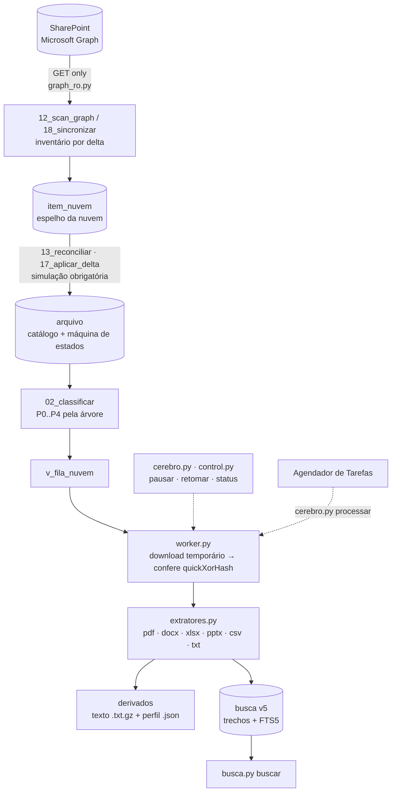

# Cérebro Documental

> **Summary in English.** Cérebro Documental is a deterministic, local-first pipeline that
> inventories, extracts and indexes an entire engineering document archive (~1.17 TB,
> ~138k files on SharePoint) so that the team can answer "where is this written?" with
> page-level citations. It reads the cloud through a **read-only** Microsoft Graph client,
> tracks every file in a SQLite state machine (nothing is ever deleted from the catalog),
> deduplicates by the server's `quickXorHash`, extracts text from PDF/DOCX/XLSX/PPTX/CSV/TXT,
> and serves full-text search with SQLite FTS5. No AI runs inside the processing loop: Claude
> Code was used to build and audit the machine, not to process documents. This public copy
> ships with a small fictitious archive so the whole pipeline runs offline in seconds.

Autora: **Emmily Maciel** · GitHub [`Emmilymaciell`](https://github.com/Emmilymaciell)

---

## Problema

Um contrato de infraestrutura rodoviária acumula, ao longo dos anos, um acervo documental
enorme no SharePoint: contratos, notificações, medições, ensaios, projetos, atas. No caso
real, **137.856 arquivos em 22.149 pastas, 1,166 TB** (inventário de 2026-09-20,
`STATE.md`). Perguntas simples — *"onde está o boletim de medição 12?"*, *"quais relatórios
citam a estaca 120?"* — dependiam de alguém lembrar o caminho da pasta.

Restrições que moldaram o projeto (`CLAUDE.md`, `STATE.md`):

- o acervo é **read-only absoluto**: nada pode ser alterado, movido ou apagado;
- quase tudo está "só na nuvem": não dá para baixar 1 TB para ler;
- o processamento leva dias e precisa sobreviver a quedas, reinícios e pausas;
- nenhum documento pode ser enviado a serviço externo de IA.

## Solução

Um **processador autônomo e persistente**, 100% determinístico:

1. **Inventário** do acervo inteiro pelo *delta* do Microsoft Graph, sem baixar nada.
2. **Classificação P0..P4** pela própria árvore de pastas (obra + categoria documental),
   que define a **ordem** da fila — o escopo é sempre o acervo inteiro.
3. **Worker** que baixa cada arquivo para uma pasta temporária, confere o hash com o do
   servidor, extrai o texto, grava os derivados e apaga o temporário. Uma transação por item:
   queda de energia custa um arquivo, não um dia.
4. **Deduplicação por conteúdo**: cópias idênticas são extraídas uma vez só, e a busca
   devolve **todos** os lugares onde o conteúdo aparece.
5. **Busca v5** em SQLite FTS5, com trechos de até 1.500 caracteres alinhados a início de
   palavra e sem atravessar página, slide ou aba.

## Arquitetura



Princípio que governa tudo (`docs/01_ARQUITETURA.md`):
`código local determinístico → extração estruturada → indexação → heurística → IA só quando necessária`.

Documentação técnica completa em [`docs/`](docs/): esquema SQLite, política de duplicatas,
extratores, busca, operação autônoma, auditoria de QA e prontidão para a massificação.

## Números

| | Valor | Fonte |
|---|---|---|
| Acervo inventariado | 137.856 arquivos · 22.149 pastas · 1,166 TB | `STATE.md`, inventário E4 (2026-09-20) |
| Testes offline | **1.671 PASS / 0 FAIL** em 15 suítes | `STATE.md` / `CLAUDE.md` (execução de 2026-10-04) |
| Testes com rede | 66 PASS / 0 FAIL (`graph_ro` 57 + `quickxor` 9) | `STATE.md` |
| Mapeamento local ↔ nuvem | 147/149 caminhos resolvidos (98,7%) | `STATE.md`, etapa E2 |
| Ritmo medido (amostra E7, 39 arquivos) | ~23 itens/min · ~1,1 MB/s com 1 worker | `scripts/cerebro.py` (comentário de concorrência) |
| Decisões registradas | `DEC-001` a `DEC-045` | `STATE.md`, "Decisões tomadas" |

Estado honesto: o código está pronto para a massificação, mas o veredito de prontidão
registrado é **NO-GO** até as etapas G5–G11 de
[`docs/13_PRONTIDAO_MASSIFICACAO.md`](docs/13_PRONTIDAO_MASSIFICACAO.md) (`STATE.md`).

## Como rodar (com os dados fictícios)

Requisitos: Python 3.12 e as dependências de `requirements.txt`. Não precisa de SharePoint
nem de credencial: a demo usa `fonte: local` sobre `examples/acervo_ficticio/`
(9 arquivos inventados, incluindo uma cópia duplicada de propósito).

```bash
pip install -r requirements.txt

# 1. monta a config da demo (saídas em examples/demo_saida/, ignorada pelo Git)
python examples/gerar_config_demo.py
C=examples/demo_saida/config_demo.yaml

# 2. pipeline
python scripts/00_init_db.py --config $C
python scripts/01_scan_inventario.py --config $C --quieto
python scripts/02_classificar.py --config $C
python scripts/05_migrar_v5.py --aplicar --sem-backup --config $C
python scripts/worker.py run --uma-vez --fonte local --ignorar-janela --config $C
python scripts/99_status.py --config $C        # 8 COMPLETED + 1 DUPLICATE

# 3. busca
python scripts/busca.py buscar "faixa de dominio RD-101" --banco examples/demo_saida/demo.db
python scripts/busca.py buscar "compactacao estaca 120"  --banco examples/demo_saida/demo.db
```

O resultado da busca mostra o trecho, a prioridade e **todos** os caminhos onde o conteúdo
aparece (o contrato e a sua cópia na pasta "0 - Obsoleto" saem juntos).
Uma fotografia do índice gerado está em
[`examples/indice_ficticio.json`](examples/indice_ficticio.json)
(regerável com `python examples/exportar_indice.py`).

Testes: cada suíte é um script independente (`python tests/test_scanner.py`). As partes que
falam com o Graph real precisam de `.env` (modelo em `.env.example`) e podem ser puladas com
`--sem-rede`.

## Limitações conhecidas

- O veredito de prontidão registrado para a massificação é **NO-GO** até as etapas G5–G11 de [`docs/13_PRONTIDAO_MASSIFICACAO.md`](docs/13_PRONTIDAO_MASSIFICACAO.md); processamento em massa, paralelismo e loop contínuo não foram liberados.
- **Sem OCR**: PDFs com páginas escaneadas vão para `OCR_REQUIRED` (o texto das outras páginas é indexado); o OCR depende de instalar o Tesseract e de medir uma amostra real, e a regra de detecção (`DEC-043`) é provisória.
- Imagens, CAD, vídeo e outros formatos sem extrator ficam catalogados como `UNSUPPORTED`, sem texto indexado.
- A busca é **lexical** (SQLite FTS5); não há busca semântica por embeddings.
- A leitura real exige app no Entra ID com acesso de leitura ao SharePoint e `.env`; a demo pública roda só sobre `examples/acervo_ficticio/`.
- `tests/test_hidratacao.py` é manual contra OneDrive real e fica fora da rodada offline.

## O que eu decidi × o que a IA gerou

O código foi escrito com **Claude Code** (e Codex) como ferramenta, sob minha especificação
e revisão (`PROVENANCE.md`). A divisão, pelo que está registrado nas decisões do
`STATE.md`:

**Decisões de produto e arquitetura (minhas):**

- **Escopo é o acervo inteiro**; prioridade P0..P4 é ordem, não recorte (`DEC-005`).
- **Nenhuma IA dentro do laço de processamento** e nenhum documento enviado para fora —
  é arquitetura, não fase (`DEC-006`, `DEC-039`).
- **A nuvem é a fonte única**, lida por um cliente que só faz `GET`; escrita no SharePoint é
  de outro projeto (`DEC-012`, `DEC-014`, `docs/06_FRONTEIRA_PROJETOS.md`).
- **Nada some do catálogo**: sem extrator vira `UNSUPPORTED`, sumiu vira `MISSING` e volta
  se reaparecer (`DEC-003`, `DEC-029`).
- Duplicata se decide por **hash, nunca por nome**, com níveis de evidência (`DEC-018`,
  `DEC-025`).
- Recortes de escopo (uma biblioteca de outro site ficou fora — `DEC-017`, "decisão da
  Emmily" em `config/projeto.yaml`) e a aplicação de correções no banco de produção ficam
  comigo (`STATE.md`).
- **A conversa é descartável; o repositório é a fonte canônica** — protocolo de sessão com
  `/session-start` e `/session-close` (`DEC-040`, `docs/12_CONTINUIDADE.md`).

**Gerado com IA sob minha revisão:**

- Implementação dos scripts, extratores, worker, migrações de schema e da suíte de testes.
- Auditorias de QA que encontraram e documentaram defeitos
  (`docs/11_QA_AUDITORIA.md`, `docs/11a_QA_VACUIDADE.md`).
- Parâmetros do corte da busca (`DEC-041`): deleguei a escolha ao sprint, condicionada a
  medição comparativa entre cinco políticas (`docs/09_BUSCA.md`).

## Stack

Python 3.12 · SQLite + FTS5 · Microsoft Graph (somente leitura, delta + `quickXorHash`) ·
PyMuPDF · python-docx · openpyxl · python-pptx · PyYAML · PowerShell / Agendador de Tarefas
do Windows · Claude Code e Codex (construção e auditoria).

## Verificação, sanitização e licença

- **Testes:** cada `tests/test_*.py` executado como script (`graph_ro` e `quickxor` com `--sem-rede`) → **17 suítes, 1726 PASS / 0 FAIL** em 19/11/2026.
- **Dados:** fictícios — cópia sanitizada de um sistema em uso real; nenhum dado de cliente ou de terceiro.
- **Sanitização:** o que foi removido, trocado ou inventado nesta cópia está em [`SANITIZACAO.md`](SANITIZACAO.md).
- **Licença:** todos os direitos reservados; leitura permitida para avaliação de portfólio — ver [`LICENSE`](LICENSE) e [`NOTICE`](NOTICE).

---

> **Aviso:** Dados fictícios. Versão sanitizada de um sistema em uso real; identificadores do
> cliente foram substituídos.
